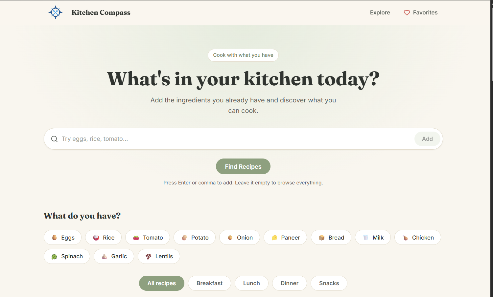

# What's in My Kitchen?

A clean, minimal recipe finder built with **React**. Enter the ingredients you already have and discover what you can cook.



## Features

- **Ingredient search**: type ingredients (press Enter or comma to add, or paste a list like `eggs, rice, tomato`) and see them as removable chips
- **Popular ingredients**: one-click chips to add or remove common ingredients, plus a "Clear all" button
- **Meal type filters**: All, Breakfast, Lunch, Dinner, and Snacks
- **Smart matching**: recipes are ranked by how many of your ingredients they use, and pantry staples (salt, oil, water, and so on) are ignored
- **Sorting**: best match, shortest time, or longest time
- **Recipe cards**: image, name, cooking time and difficulty, ingredients matched, favorite button, and a details action
- **Recipe details modal**: large image, time, servings, ingredient list that highlights what you have and what you need, and numbered cooking steps
- **Favorites**: save recipes with the heart button; they persist after a refresh and can be viewed in a slide-in panel
- **Responsive and accessible**: mobile menu, keyboard support (Esc to close, focus trapping in dialogs), and reduced-motion support

## Tech stack

- [React](https://react.dev/) (JavaScript, function components and hooks)
- [Vite](https://vite.dev/) for development and builds
- [Lucide React](https://lucide.dev/) for interface icons
- [React Icons](https://react-icons.github.io/react-icons/) for social media logos
- Plain CSS with design tokens (no UI framework)
- `localStorage` for saving favorites (no backend)

## Getting started

### Prerequisites

- [Node.js](https://nodejs.org/) 20 or newer
- npm (comes with Node.js)

### Installation

```bash
# Clone the repository
git clone <your-repository-url>
cd whats-in-my-kitchen

# Install dependencies
npm install

# Start the development server
npm run dev
```

Open the local address shown in the terminal (usually `http://localhost:5173`).

### Available scripts

| Command | What it does |
|---|---|
| `npm run dev` | Starts the development server with hot reload |
| `npm run build` | Creates an optimized production build in `dist/` |
| `npm run preview` | Serves the production build locally for testing |
| `npm run lint` | Runs ESLint (if included in your Vite template) |

## Project structure

```
whats-in-my-kitchen/
├── index.html
├── package.json
├── public/
│   ├── logo.jpg                  # site logo
│   └── images/
│       └── recipes/              # recipe photos
└── src/
    ├── main.jsx                  # entry point, wraps the app in FavoritesProvider
    ├── App.jsx                   # page layout and shared state
    ├── components/
    │   ├── Header.jsx            # logo, navigation, favorites link, mobile menu
    │   ├── Hero.jsx              # headline and ingredient search input
    │   ├── IngredientChips.jsx   # selected ingredient chips
    │   ├── PopularIngredients.jsx
    │   ├── MealFilter.jsx
    │   ├── RecipeGrid.jsx        # results header, sorting, grid, empty state
    │   ├── RecipeCard.jsx
    │   ├── RecipeModal.jsx       # recipe details dialog
    │   ├── FavoritesDrawer.jsx   # saved recipes panel
    │   └── Footer.jsx
    ├── context/
    │   └── FavoritesContext.jsx  # favorites state shared across the app
    ├── data/
    │   ├── recipes.js            # recipe data
    │   └── ingredients.js        # popular ingredient list
    ├── hooks/
    │   └── useLocalStorage.js    # useState that persists to localStorage
    ├── utils/
    │   ├── formatIngredient.js   # cleans up typed ingredient text
    │   └── matchRecipes.js       # matching, filtering, and ranking logic
    └── styles/
        ├── tokens.css            # colors, fonts, spacing, radii
        ├── global.css            # resets and shared classes
        ├── header.css
        ├── hero.css
        ├── filters.css
        ├── recipes.css
        ├── modal.css
        ├── drawer.css
        └── footer.css
```

## How it works

### State

Shared state lives in `App.jsx`: the selected ingredients, the active meal type, and which recipe is open. Favorites live in `FavoritesContext` and are stored in `localStorage` under the key `kitchen-favorites`.

### Matching logic

`src/utils/matchRecipes.js` takes the recipe list, the selected ingredients, and the meal type, and returns recipes with extra fields (`matchedCount`, `totalCount`, `missing`).

- With **no ingredients selected**, every recipe in the chosen meal type is shown.
- With **ingredients selected**, only recipes that use at least one of them are shown.
- Results are ranked by most matches, then fewest missing ingredients, then shortest time.
- Names are normalized so `Tomatoes`, `tomato`, and `TOMATO` all match.
- **Pantry staples** are ignored when counting matches: salt, pepper, oil, water, sugar, turmeric, cumin, garam masala, and cardamom. Edit the `PANTRY_STAPLES` list in `matchRecipes.js` to change this.

Matching compares exact ingredient names, so `chilli` does not match `green chilli`.

## Adding a recipe

Add an object to the `recipes` array in `src/data/recipes.js`:

```js
{
  id: "masala-omelette",        // unique, lowercase, used for the image file name
  name: "Masala Omelette",
  mealType: "breakfast",        // breakfast | lunch | dinner | snacks
  time: 10,                     // total minutes
  difficulty: "Easy",           // Easy | Medium
  servings: 1,
  emoji: "🍳",                  // shown if the photo is missing
  ingredients: [
    i("eggs", "3"),
    i("onion", "1 small, chopped"),
    i("salt", "to taste"),
  ],
  steps: [
    "Beat the eggs with salt.",
    "Cook in a hot pan for 3 minutes.",
  ],
}
```

Use the same lowercase ingredient names that appear in the popular ingredient list so matching works.

## Adding recipe photos

1. Put your image in `public/images/recipes/`.
2. Name it after the recipe `id`, for example `masala-omelette.jpg`.

If a photo is missing, the card shows the recipe's emoji instead. All photos are cropped to the same shape (4:3 on cards, 16:9 in the modal) using `object-fit: cover`, so any image size works. A size of about 800×600 px and under 200 KB per image keeps the page fast.

To use another format or file name for one recipe, set `image` on that recipe, for example `image: "/images/recipes/masala-omelette.png"`. For this to take effect, the export at the bottom of `recipes.js` must keep an existing value:

```js
export const RECIPES = recipes.map((recipe) => ({
  ...recipe,
  image: recipe.image ?? `/images/recipes/${recipe.id}.jpg`,
}));
```

## Customizing the look

All colors, fonts, spacing, and corner radii are CSS variables in `src/styles/tokens.css`. Change them there to restyle the whole site.

| Variable | Used for |
|---|---|
| `--cream`, `--cream-dark` | Page background and footer |
| `--sage`, `--sage-dark`, `--sage-light` | Primary accent, buttons, selected states |
| `--charcoal`, `--charcoal-soft` | Text |
| `--font-heading`, `--font-body` | Fraunces (headings) and Inter (body), loaded from Google Fonts in `index.html` |

To change the logo, replace `public/logo.jpg` or update the `src` in `Header.jsx` and `Footer.jsx`. To change the social links, edit the `SOCIALS` list at the top of `Footer.jsx`.

## Deployment

Create a production build:

```bash
npm run build
```

The `dist/` folder can be hosted on any static host, such as Vercel, Netlify, Cloudflare Pages, or GitHub Pages. Use `npm run build` as the build command and `dist` as the output directory.

If you deploy to a sub-path (for example GitHub Pages at `username.github.io/repo-name/`), set `base: "/repo-name/"` in `vite.config.js`, and change image paths such as `/logo.jpg` to use `import.meta.env.BASE_URL`.

## Ideas for the future

- Separate preparation and cooking times
- More recipes and dietary filters (vegetarian, vegan, high protein)
- Looser ingredient matching (for example `chilli` matching `green chilli`)
- Search by recipe name
- Shareable links for a search or a recipe
- Unit tests for the matching logic

